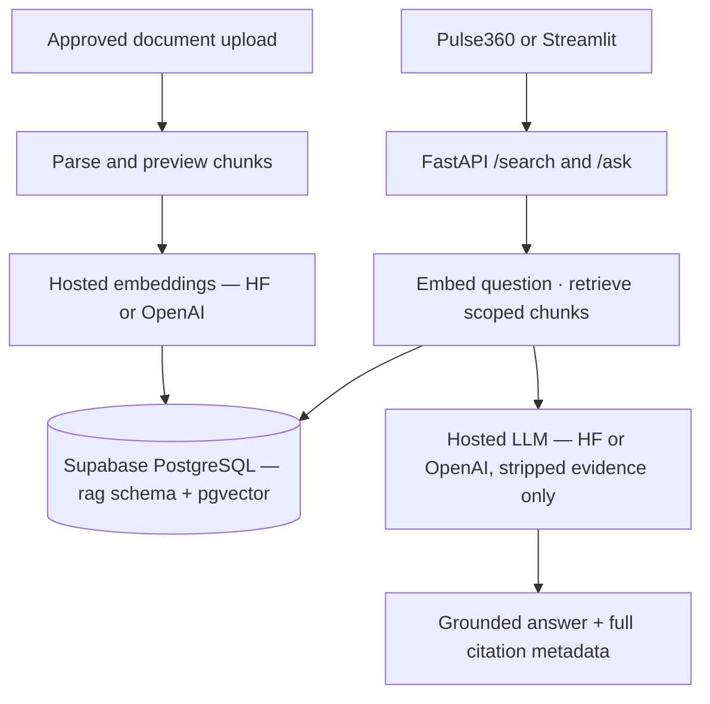

# Supabas_pulse360_RAG

Supabase-backed FAQ RAG service for Pulse360. FastAPI backend with pgvector
similarity search, hosted embeddings (HuggingFace by default, OpenAI optional)
and LLM synthesis (HuggingFace or OpenAI), and a Streamlit workspace UI.
Uploads accept PDF, DOCX, TXT and Markdown.

## To deploy
Before pushing to Vercel, run these two migrations against your Supabase project:

psql "$SUPABASE_DATABASE_URL" -f docs/migrations/001_add_rag_previews.sql
psql "$SUPABASE_DATABASE_URL" -f docs/migrations/002_add_rate_limits.sql

Then set the required Vercel environment variables from `.env.example` and
deploy after validating the schema and provider configuration for your project.

## Current status

The codebase is **Supabase-only**. All Qdrant, SQLite, and Chroma adapters
have been removed. The FastAPI document routes, Streamlit workspace, and
standalone smoke-test all use the direct Supabase/pgvector path.

**Test suite:** offline pytest suite under `tests/` (`uv run pytest -q`). An
autouse fixture in `tests/conftest.py` blanks the database URL, provider keys and
API keys for every test that is not marked `live`, so a filled-in `.env` does not
make the suite reach the real database or model APIs. Last run:
112 passed, 4 skipped (`tests/test_streamlit_ui.py` excluded, and
`tests/test_live_openai_pgvector.py` is a live test that is skipped by default).

**Box sync (optional):** `scripts/sync_box.py` keeps a collection in step with a Box
file or folder. See [docs/box-sync.md](docs/box-sync.md).

**Code review progress:** 25 findings tracked: 23 fixed, 2 moot (#11, #12 — the
files they referred to were deleted). See the
[code-review artifact](.bob/artifacts/code-review-supabas-pulse360-rag.html)
and [BUG_AUDIT.md](BUG_AUDIT.md) for full details.

## Architecture



See [docs/architecture.md](docs/architecture.md) for the full sequence diagram
and contract details.

## Quick start

```powershell
uv sync --extra dev
uv run pytest -q
```

To run the Streamlit workspace (requires `SUPABASE_DATABASE_URL` in `.env`):

```powershell
uv sync --extra ui
uv run streamlit run streamlit_app.py --server.port 8502
```

To run the API server locally:

```powershell
uv run uvicorn main:app --host 127.0.0.1 --port 8767
```

No `.env` is included in the repository. Create the private file at the project
root and set at minimum:

```dotenv
SUPABASE_DATABASE_URL=<your direct/session Supabase connection string>
ADMIN_API_KEY=<long unique secret for the document-library API routes>
HF_TOKEN=<your HuggingFace API token>
EMBEDDING_URL=<your hosted embedding endpoint>
LLM_MODEL=<model id on the configured LLM provider>
```

Provider selection: `EMBEDDING_PROVIDER` (`huggingface` default, or `openai`)
and `LLM_PROVIDER` (`huggingface` default, or `openai`). OpenAI use needs
`OPENAI_API_KEY`. A collection must be queried with the model that embedded it,
so changing the embedding provider or model means re-embedding documents.

See `.env.example` for all supported keys and defaults.
`ADMIN_API_KEY` is required for `/collections` routes. `/search` and `/ask`
require `QUERY_API_KEY` (sent as `X-API-Key`) unless `APP_ENV=local`, and may
only query collections listed in `PUBLIC_COLLECTIONS` (default: `COLLECTION`).
Use different values for the two keys. Outside `APP_ENV=local`, `EMBEDDING_URL`
and `LLM_BASE_URL` must be HTTPS. Set `APP_ENV=production` on Vercel so a
missing `QUERY_API_KEY` fails closed. Both routes are also rate-limited per
visitor: callers that present a valid `QUERY_API_KEY` may name the end user in
`X-Forwarded-Client-IP`; all other callers are limited by socket peer. The limit
is 30 requests per IP per 60 seconds, counted in the Supabase `rag.rate_limits`
table (shared across workers); if the database is unreachable the limiter falls
back to an in-process counter.

## API endpoints

| Method | Route | Auth |
| --- | --- | --- |
| GET | `/health` | none (liveness only) |
| POST | `/search` | `X-API-Key` = `QUERY_API_KEY` (open only when `APP_ENV=local`) |
| POST | `/ask` | `X-API-Key` = `QUERY_API_KEY` (open only when `APP_ENV=local`) |
| GET, POST | `/collections` | `X-API-Key` = `ADMIN_API_KEY` |
| GET | `/collections/{id}/documents` | `X-API-Key` = `ADMIN_API_KEY` |
| POST | `/collections/{id}/uploads/preview` | `X-API-Key` = `ADMIN_API_KEY` |
| POST | `/collections/{id}/documents` | `X-API-Key` = `ADMIN_API_KEY` |

Vercel runs `main.py` (see `vercel.json`).

## Supabase pgvector smoke test

The standalone `supabase_pgvector_test.py` Streamlit page validates the `rag`
schema, 384-dimensional embedding writes, and `rag.match_document_chunks`
retrieval directly against Supabase. It writes only to the configured test
collection and uses the same psycopg3 type adapter as the production path —
no raw vector string interpolation.

```powershell
uv run streamlit run supabase_pgvector_test.py --server.address 127.0.0.1 --server.port 8503
```

After testing, clean up test documents:

```powershell
uv run python scripts/delete_supabase_test_document.py
```

Cleanup removes only documents with the `__pgvector_test__/` filename prefix.
It never drops the collection. Full instructions:
[`docs/supabase-pgvector-smoke-test.md`](docs/supabase-pgvector-smoke-test.md).

## Schema requirements

`commit()` and `insert_document()` both supply `sha256`, `checksum`, and
`content_hash` as candidate hash column values. The column filter keeps only
whichever one exists in your live schema. Before your first embed, confirm
these NOT NULL columns are present:

- **`rag.documents.sha256`** (or `checksum` / `content_hash`)
- **`rag.document_chunks.ordinal`** (or `chunk_index`)
- **`rag.collections`** must have a row matching your collection ID

To list every NOT NULL column the code must fill:

```sql
select table_name, column_name
from information_schema.columns
where table_schema = 'rag'
  and table_name in ('documents', 'document_chunks')
  and is_nullable = 'NO'
  and column_default is null
order by table_name, ordinal_position;
```

## My Supabase pgvectorDB Output:


## Guides

- [Architecture and contracts](docs/architecture.md)
- [Bug audit and fix history](BUG_AUDIT.md)
- [Smoke test guide](docs/supabase-pgvector-smoke-test.md)
- [Testing guide](docs/testing.md)
- [Upload guide](docs/ui-testing.md)
