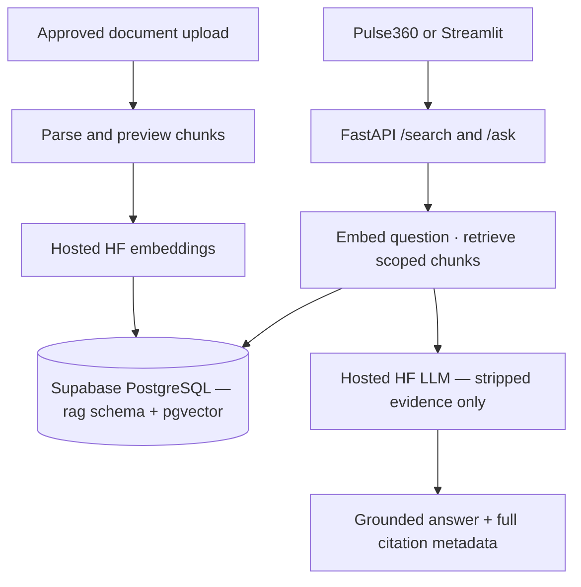

# Supabas_pulse360_RAG

Supabase-backed FAQ RAG service for Pulse360. FastAPI backend with pgvector
similarity search, hosted HuggingFace embeddings and LLM synthesis, and a
Streamlit workspace UI.

## Current status

The codebase is **Supabase-only**. All Qdrant, SQLite, and Chroma adapters
have been removed. The FastAPI document routes, Streamlit workspace, and
standalone smoke-test all use the direct Supabase/pgvector path.

**Test suite:** 70/70 offline tests pass. No live database or API keys required
to run tests.

**Code review progress:** All 25 findings resolved (100%). See the
[code-review artifact](.bob/artifacts/code-review-supabas-pulse360-rag.html)
and [BUG_AUDIT.md](BUG_AUDIT.md) for full details.

## Architecture



See [docs/architecture.md](docs/architecture.md) for the full sequence diagram
and contract details.

## Quick start

```powershell
uv sync --extra dev
uv run pytest -q
```

To run the Streamlit workspace (requires `SUPABASE_DATABASE_URL` in `.env`):

```powershell
uv sync --extra ui
uv run streamlit run streamlit_app.py --server.port 8502
```

To run the API server locally:

```powershell
uv run uvicorn main:app --host 127.0.0.1 --port 8767
```

No `.env` is included in the repository. Create the private file at the project
root and set at minimum:

```
SUPABASE_DATABASE_URL=<your direct/session Supabase connection string>
HF_TOKEN=<your HuggingFace API token>
EMBEDDING_URL=<your hosted TEI endpoint>
LLM_MODEL=<model id on HuggingFace router>
```

See `.env.example` for all supported keys and defaults.

## Supabase pgvector smoke test

The standalone `supabase_pgvector_test.py` Streamlit page validates the `rag`
schema, 384-dimensional embedding writes, and `rag.match_document_chunks`
retrieval directly against Supabase. It writes only to the configured test
collection and uses the same psycopg3 type adapter as the production path —
no raw vector string interpolation.

```powershell
uv run streamlit run supabase_pgvector_test.py --server.address 127.0.0.1 --server.port 8503
```

After testing, clean up test documents:

```powershell
uv run python scripts/delete_supabase_test_document.py
```

Cleanup removes only documents with the `__pgvector_test__/` filename prefix.
It never drops the collection. Full instructions:
[`docs/supabase-pgvector-smoke-test.md`](docs/supabase-pgvector-smoke-test.md).

## Schema requirements

`commit()` and `insert_document()` both supply `sha256`, `checksum`, and
`content_hash` as candidate hash column values. The column filter keeps only
whichever one exists in your live schema. Before your first embed, confirm
these NOT NULL columns are present:

- **`rag.documents.sha256`** (or `checksum` / `content_hash`)
- **`rag.document_chunks.ordinal`** (or `chunk_index`)
- **`rag.collections`** must have a row matching your collection ID

To list every NOT NULL column the code must fill:

```sql
select table_name, column_name
from information_schema.columns
where table_schema = 'rag'
  and table_name in ('documents', 'document_chunks')
  and is_nullable = 'NO'
  and column_default is null
order by table_name, ordinal_position;
```

## My Supabase pgvectorDB Output:


## Guides

- [Architecture and contracts](docs/architecture.md)
- [Bug audit and fix history](BUG_AUDIT.md)
- [Smoke test guide](docs/supabase-pgvector-smoke-test.md)
- [Testing guide](docs/testing.md)
- [Upload guide](docs/ui-testing.md)
