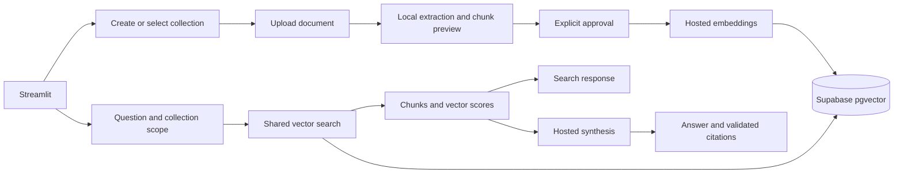

# Local setup and project layout

A document workspace backed by Supabase PostgreSQL + pgvector: create a collection,
upload a document, review chunks, approve hosted embeddings, then search or ask
questions with source citations. FastAPI serves the backend, Streamlit is the test
UI, and a hosted provider (Hugging Face by default, OpenAI optional) supplies
embeddings and answers.

## Project structure

```text
README.md
pyproject.toml                # Dependencies and tool settings
uv.lock                       # Reproducible dependency resolution
.env.example                  # Configuration reference, without secrets
.env                          # Private local configuration; ignored by Git
main.py                       # FastAPI entry point (also the Vercel entry, see vercel.json)
streamlit_app.py              # Production workspace UI
supabase_pgvector_test.py     # Smoke-test UI for the rag schema
src/faq_agent/
  config.py                   # Validated, type-coerced settings
  schemas.py                  # Document, chunk and retrieval data types
  supabase_store.py           # SupabaseLibrary: preview, approve, commit, search
  db_helpers.py               # Direct-PostgreSQL helpers shared by both Streamlit pages
  rate_limiter.py             # Per-IP limiter (rag.rate_limits, in-process fallback)
  ingestion/loader.py         # Local file loading and .docx text extraction
  integrations/               # Box source and sync (see box-sync.md)
  chunking/chunker.py         # Section-aware character windows
  embeddings/embedder.py      # Hosted embedding client and vector validation
  retrieval/retriever.py      # Shared search and answer workflow
  prompts/templates.py        # Grounding instructions and abstention text
  llm/client.py               # Hosted synthesis and citation validation
  api/
    routes.py                 # Health, search and ask
    documents.py              # Collection and upload endpoints
scripts/                      # Environment setup, retrieval evaluation, Box sync, test-data cleanup
tests/                        # Offline unit, integration and UI tests
docs/
  architecture.md             # Responsibilities, data flow, contracts, limitations
  ui-testing.md               # Upload workflow and API reference
  testing.md                  # Automated and live verification
  supabase-pgvector-smoke-test.md
  box-sync.md                 # Optional Box-to-Supabase document sync
  migrations/                 # SQL to run against Supabase before deployment
BUG_AUDIT.md                  # Verification, recovery and fix record
```

Dependencies live in `pyproject.toml` and `uv.lock`; no `requirements.txt` is
maintained. Settings live in `config.py` and `.env`.

## Run locally

Requires Python 3.11-3.13 and uv. There is no local vector database or container:
all state is in your Supabase project.

```powershell
uv sync --locked --extra dev --extra ui
uv run python scripts/setup_env.py --sync
uv run python scripts/setup_env.py --token
```

The setup script backs up an existing `.env` before merging current keys; it
preserves configured values and never prints credentials. Set
`SUPABASE_DATABASE_URL`, `ADMIN_API_KEY`, `EMBEDDING_URL`, `HF_TOKEN` and `LLM_MODEL`
privately, and run the SQL files in `docs/migrations/` once.

Start each server in a separate terminal from the repository root:

```powershell
uv run uvicorn main:app --host 127.0.0.1 --port 8767
```

```powershell
uv run streamlit run streamlit_app.py --server.address 127.0.0.1 --server.port 8502 --server.maxUploadSize 10 --browser.gatherUsageStats false
```

Open [Streamlit](http://127.0.0.1:8502) or [Swagger](http://127.0.0.1:8767/docs).
Restart the API after changing settings. `FAQ_API_URL` overrides the UI's API address.

## Workflow



Preview is local and makes no model calls. Embed and store sends approved text to
the configured embedding endpoint. Search embeds the question; Ask uses the same
retrieval function and then generates an answer. Reranking is not currently used;
the compatibility response field `rerank_score` is null.

## Verification and boundaries

- [Tests and evaluation](testing.md)
- [Architecture and configuration](architecture.md)
- [UI workflow and endpoint reference](ui-testing.md)

Keep local servers on loopback. The document-library API uses a shared admin key,
not per-user authorization. There is no OCR or background ingestion. Hosted model
usage may consume credits; the application does not enforce provider billing caps.
