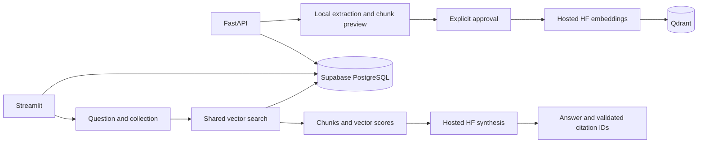

# Supabase pgvector workspace

The Streamlit UI and FastAPI service connect directly to Supabase PostgreSQL.
Keep database and provider credentials in the server-side `.env`; do not expose
them to a browser or commit them.

## Run

From the repository root, install with `uv sync --extra dev --extra ui`.
Run each server in a separate terminal:

```powershell
.\.venv\Scripts\python.exe -m uvicorn faq_agent.api:app --app-dir src --host 127.0.0.1 --port 8767
.\.venv\Scripts\python.exe -m streamlit run streamlit_app.py --server.address 127.0.0.1 --server.port 8502 --browser.gatherUsageStats false
```

Open http://127.0.0.1:8502. The UI can run without the API server; use the API
server for `/search`, `/ask`, and the document-library endpoints.

The document-library API routes require an admin key. Set `ADMIN_API_KEY` in
your private `.env` file to a long, unique secret. Send that value in the
`X-API-Key` header for every `/collections` request. These routes remain locked
when the variable is unset.

## Workflow

1. Select an existing collection from `rag.collections`. To create one, use the
   authenticated `POST /collections` API endpoint or create it in Supabase.
2. Upload a PDF, TXT, or Markdown file and select Preview chunks.
3. Review the text, page number and chunk count. Preview makes no HF calls.
4. Approve hosted processing, then select Embed and store. This sends the chunks
   to the configured embedding endpoint and writes vectors/text to Supabase.
5. Open Questions. Choose Search for chunks and vector scores, or Answer for
   retrieval followed by hosted LLM synthesis with citations. Optionally scope
   to one document. Each question is independent; displayed history is not sent
   as conversational memory.

The Streamlit UI uses direct PostgreSQL helpers. The API's `/search` and `/ask`
routes use the shared retrieval service and the configured default collection
when `collection_id` is omitted.

## API

| Method | Route | Purpose |
| --- | --- | --- |
| GET | /collections | List collections (`X-API-Key` required) |
| POST | /collections | Create with `{"name":"pulse360_faq"}` (`X-API-Key` required) |
| GET | /collections/{id}/documents | List committed documents (`X-API-Key` required) |
| POST | /collections/{id}/uploads/preview | Multipart `file`; extract and chunk locally (`X-API-Key` required) |
| POST | /collections/{id}/documents | `preview_id` and `approved:true`; embed/store (`X-API-Key` required) |
| POST | /search | question, optional collection_id and document_id |
| POST | /ask | Same retrieval scope, then HF synthesis |

## Boundaries

- Supabase PostgreSQL stores collections, documents, chunks, vectors, and API
  previews. Run the migrations in `docs/migrations/` before deployment.
- API preview IDs expire after one hour. Expired preview rows are removed when
  a new API preview is created.
- PDF/TXT/MD only: 10 MB, 100 PDF pages, 100,000 extracted characters and at most
  100 chunks. Scanned PDFs require OCR elsewhere. PDF extraction is page-by-page.
- Chunking uses configured CHUNK_CHARS and CHUNK_OVERLAP (defaults 1000/150),
  section headings and whitespace boundaries. It does not guarantee whole FAQ
  question/answer pairs, especially across PDF pages. Preview before committing.
- The preview shows text and planned vector dimensions, not computed embeddings.
- Identical file content is deduplicated per collection, even when renamed.
  Failed/interrupted commits can be retried; only committed documents are searched.
- Keep the configured embedding model and vector dimensions aligned with the
  Supabase schema and collection's data.
- Reranking remains deferred. Vector scores are similarity, not accuracy/confidence.
- Hosted calls may consume credits; preview does not. The app does not impose a
  provider billing cap. Keep the account restricted to included credits.
- The document-library API uses a shared admin key, not per-user authorization.
  Protect the Streamlit deployment and database credentials; this is not a
  multi-tenant access-control model. OCR and background ingestion are not included.


